<div align="center">

# ⚡ Generate It!
### A free portfolio-website generator. Fill in a form, pick a style, download a finished website.

No coding. No account. No server. Everything happens inside the visitor's browser.

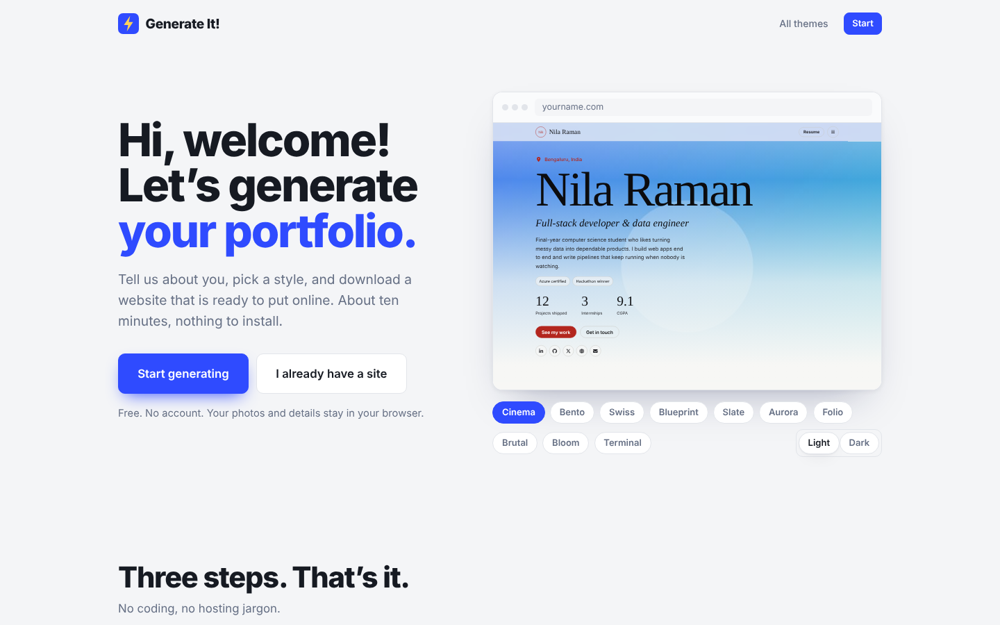

</div>

---

## 📖 Contents

1. [What is this? (the 60-second version)](#1--what-is-this-the-60-second-version)
2. [Words you'll see (mini dictionary)](#2--words-youll-see-mini-dictionary)
3. [Put it online with Vercel (about 10 minutes)](#3--put-it-online-with-vercel-about-10-minutes)
4. [What your visitors see, step by step](#4--what-your-visitors-see-step-by-step)
5. [Add a new theme (the weekly routine)](#5--add-a-new-theme-the-weekly-routine)
6. [The "New" badge: how it works](#6--the-new-badge-how-it-works)
7. [A client wants a different theme](#7--a-client-wants-a-different-theme)
8. [Run it on your own computer (optional)](#8--run-it-on-your-own-computer-optional)
9. [What is inside each folder?](#9--what-is-inside-each-folder)
10. [Troubleshooting](#10--troubleshooting)
11. [For developers](#11--for-developers)

---

## 1 · What is this? (the 60-second version)

**Generate It!** is a small website that *makes websites*.

A visitor comes to your site and does three things:

| Step | What the visitor does | Where |
| :-: | --- | --- |
| **1** | Types in their details (name, projects, skills…) | the form on the left |
| **2** | Picks a style (we call them **themes**) | the **Style & layout** page |
| **3** | Presses **Download site** | gets a `.zip` file |

Inside the zip is a complete personal portfolio website, ready to put online. It even includes its own editor (`admin.html`), so the visitor never needs to come back to your generator, except to try a new style.

**You** (the owner) only need to do two things:

1. Put this project online **once** → [Part 3](#3--put-it-online-with-vercel-about-10-minutes)
2. Add a new theme whenever you like → [Part 5](#5--add-a-new-theme-the-weekly-routine)

> 💡 **There is no database, no login and no server.** Visitors' photos and words never leave their own browser. That is why it is free to run and safe to use.

---

## 2 · Words you'll see (mini dictionary)

New to all this? Here is every technical word in this guide, in plain English.

| Word | What it means |
| --- | --- |
| **Theme / Style** | One complete look for the portfolio (colours, fonts, layout). Cinema, Bento, Swiss… are themes. |
| **Generator** | This project. The page where visitors build their site. |
| **GitHub** | A free website that stores your project files online, like Google Drive for code. |
| **Repository ("repo")** | One project folder on GitHub. |
| **Vercel** | A free service that turns your GitHub repo into a live website. |
| **Deploy** | "Publish". Vercel reads your files and makes the website live. |
| **Build** | An automatic step during deploy that checks all themes and packs everything up. |
| **`dist` folder** | The finished, ready-to-publish version of the site. Vercel makes it for you. |
| **Terminal** | A window where you type commands. Only needed in [Part 8](#8--run-it-on-your-own-computer-optional). |

---

## 3 · Put it online with Vercel (about 10 minutes)

You need two **free** accounts: [GitHub](https://github.com) and [Vercel](https://vercel.com). (Tip: sign up for Vercel using "Continue with GitHub". It's the easiest.)

### Step 1 · Unzip the project

Right-click the downloaded `.zip` file and choose **Extract All**.

> 🪟 **On Windows?** Before extracting: right-click the `.zip` → **Properties** → tick **Unblock** → **OK**. Then extract. This avoids the "potentially harmful file" error.

You will get a folder called `portfolio-generator`. Open it. You should see files like `package.json`, `build.mjs` and folders called `themes` and `src`.

### Step 2 · Upload it to GitHub

1. Log in to [github.com](https://github.com) and click **New repository** (the green button, or the **+** at the top right).
2. Give it a name, for example `my-portfolio-generator`. Keep it **Public** or **Private**, either works.
3. Click **Create repository**.
4. On the next page click the link **uploading an existing file**.
5. Open your extracted folder and select **everything inside it** (`package.json`, `build.mjs`, `themes`, `src`, `tools`, …). Drag it all into the GitHub page.
6. Wait for the upload to finish, then click **Commit changes**.

> ⚠️ Drag the **contents** of the folder, not the folder itself. `package.json` must be at the top level of the repository.
> ⚠️ Don't upload a `node_modules` folder if you have one. It is not needed.

### Step 3 · Publish it on Vercel

1. Go to [vercel.com](https://vercel.com) → **Add New… → Project**.
2. Find your repository in the list and click **Import**.
3. Don't change any settings. The file `vercel.json` already tells Vercel what to do.
4. Click **Deploy** and wait about a minute. 🎉

Vercel gives you an address like `my-portfolio-generator.vercel.app`. Open it.

### Step 4 · Check it works

- You land on the **welcome page**. Press **Start generating** to open the generator.
- Want your own address such as `generate.yourname.com`? In Vercel open **Settings → Domains**.

> 🙋 **Don't want to use GitHub?** Install [Node.js](https://nodejs.org), open a terminal in the folder, run `npm install` and then `npm run build`. Drag the new **`dist`** folder onto [vercel.com/new](https://vercel.com/new). (Each new theme then needs another build and upload.)

---

## 4 · What your visitors see, step by step

### The welcome page
Visitors land here. A live demo cycles through the themes. **Start generating** opens the form. **I already have a site** is for people who want to change the style of a site they made earlier.

### The generator

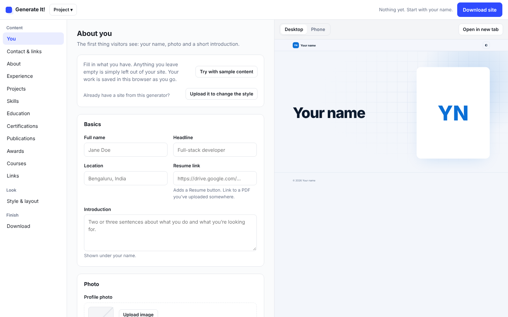

- **Left menu:** the sections of the portfolio (*You, Contact & links, About, Experience, Projects…*). Anything left empty is simply **left out** of the final site.
- **Middle:** the form for the chosen section.
- **Right:** a **live preview**. It updates as you type. Use **Desktop / Phone** to see both sizes.
- **Top right:** the **Download site** button.

> 💾 Work is saved automatically in the visitor's browser (see "Draft saved in this browser"). If they close the tab, their work is still there next time.

Not sure what to type? Press **Try with sample content** to fill everything with an example person. There is an **Undo** link right after.

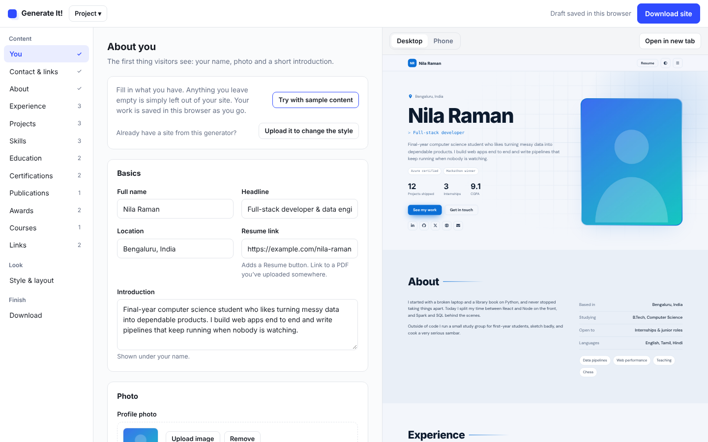

### Adding projects, jobs, skills…

Lists such as **Projects** or **Experience** work the same way: press **Add**, fill in the card, and use the small buttons to **move up / move down / remove**. Removed something by mistake? Press **Undo** in the bottom message.

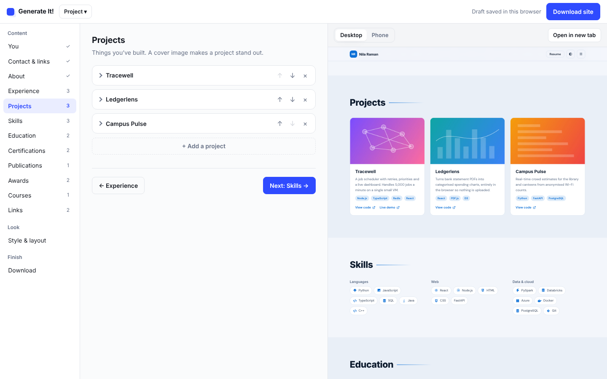

### Picking a style

Open **Style & layout** in the left menu. Click any card to try that theme instantly in the preview. Your words and photos stay exactly the same, only the look changes.

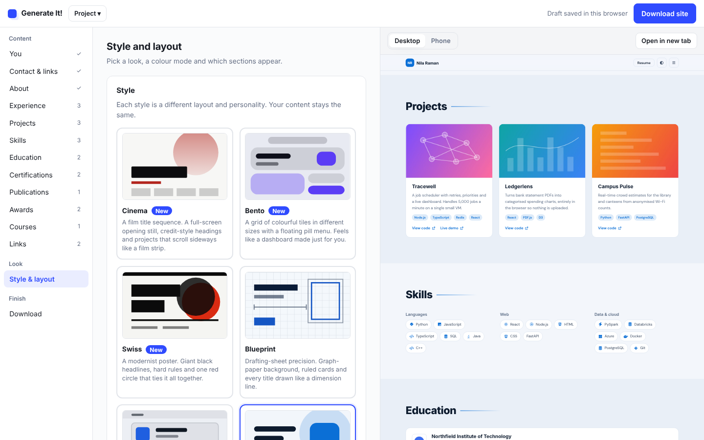

Below the style cards you can also choose:

- **Colour mode:** Light, Dark, or *Match device*.
- **Accent colour:** keep the theme's own colour or pick another.
- **Sections:** switch sections on or off, and move them up or down with the ↑ ↓ buttons.

### Download

Press **Download site**. The page shows a quick checklist (name added? photo added?) and then gives a **zip** file.

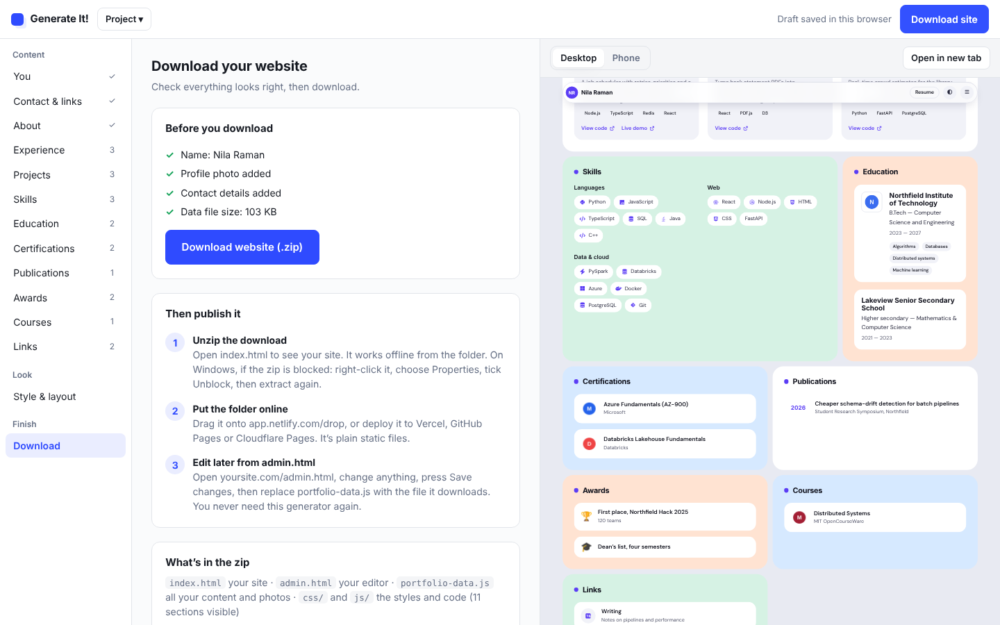

### What's inside the zip?

| File | What it is |
| --- | --- |
| `index.html` | **The website itself.** Double-click to see it. |
| `admin.html` | An **editor** with live preview. Use it to change anything later. |
| `portfolio-data.js` | **All the content** (words, settings, photos). This is the only file that changes when you edit. |
| `css/` and `js/` | The look and the code. You never need to touch them. |
| `README.txt` | A short how-to for the person who downloaded it. |

### The finished website

<table>
<tr>
<td width="68%">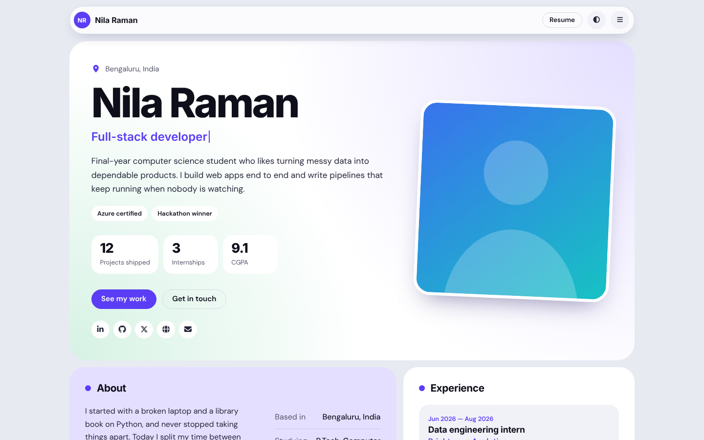</td>
<td width="32%">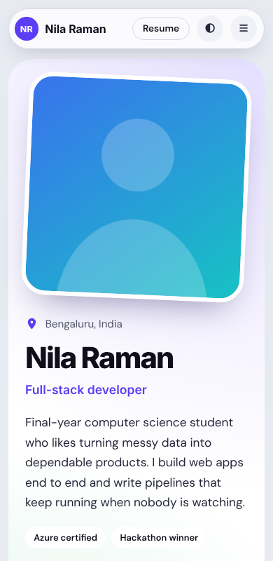</td>
</tr>
<tr>
<td align="center"><sub>On a computer</sub></td>
<td align="center"><sub>On a phone</sub></td>
</tr>
</table>

Every theme is made to look good in **light and dark mode**, and on **phones**.

### Editing later with `admin.html`

Open `yoursite.com/admin.html` (or double-click `admin.html` in the folder). It looks just like the generator.

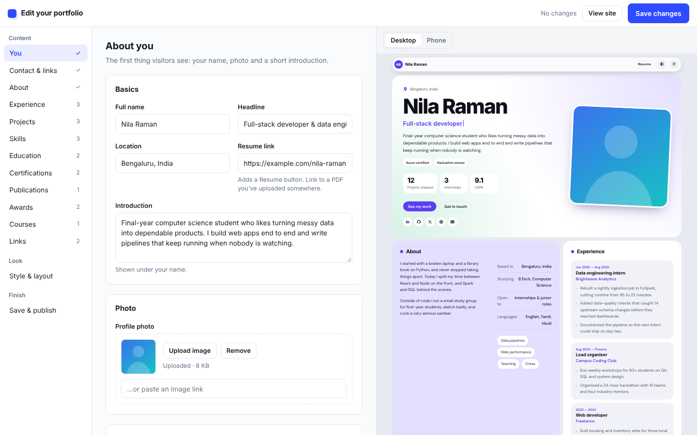

1. Change anything.
2. Press **Save changes**. Your browser downloads a new `portfolio-data.js`.
3. Replace the old `portfolio-data.js` in the website folder with the new one and publish again.

> 🔒 `admin.html` cannot change a live website by itself. It only prepares a new data file, so it is safe to leave online.

### Putting the site online

The visitor can use any free host for plain websites: [Netlify Drop](https://app.netlify.com/drop) (drag-and-drop, easiest), Vercel, GitHub Pages or Cloudflare Pages.

---

## 5 · Add a new theme (the weekly routine)

Every theme lives in its own folder inside **`themes/`**:

```
themes/
  aurora/     theme.json   theme.css   thumb.svg
  bento/      theme.json   theme.css   thumb.svg
  cinema/     theme.json   theme.css   thumb.svg
  ...
```

| File | What it does |
| --- | --- |
| `theme.json` | The theme's name, one-line description, fonts, colours, and **release date**. |
| `theme.css` | The actual design. |
| `thumb.svg` | The small preview picture on the style card. |

### To add a theme
Put its folder inside `themes/` and upload it to GitHub (in GitHub: **Add file → Upload files**, keep the folder structure). **Vercel rebuilds by itself** and the theme appears in the generator and the gallery about a minute later. **You don't change any code.**

### To remove a theme
Delete its folder from `themes/`. Websites that people already downloaded keep working and keep their style.

### To *make* a new theme (on your computer)

```bash
npm install                                  # once
npm run new-theme -- sunrise "Sunrise"       # creates themes/sunrise/
npm run dev                                  # rebuilds every time you save
npm run check-themes                         # must pass before you upload
```

- Want to start from an existing look? Add `--from slate` to the second command.
- After `npm run dev`, keep `dist/gallery.html` open and refresh it to see all themes side by side.
- Then edit `theme.css` (colours first, then one special touch) and `theme.json` (name, blurb, fonts, colours).

### 🛡️ The safety net
Every build **checks every theme** (text contrast, light *and* dark mode, no style leaking into other themes). **If a theme fails, the deploy fails and the old version stays live.** Nothing broken ever reaches your visitors. If a deploy fails, open it in Vercel and read the build log. It says exactly what to fix.

### The gallery
`yourwebsite.com/gallery.html` shows every theme side by side, in light and dark, on desktop and phone. Share it with visitors if you like.

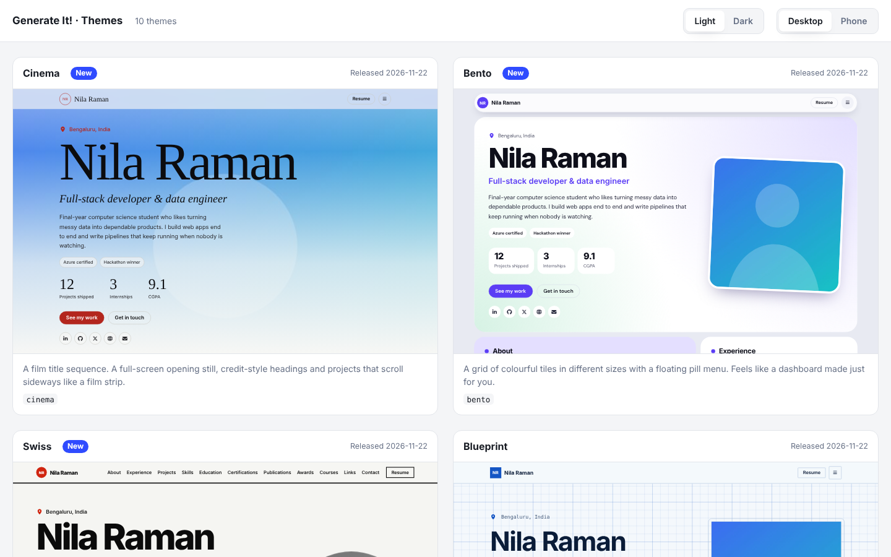

---

## 6 · The "New" badge: how it works

Themes show a blue **New** badge. The rule is simple:

> ### 🏷️ Only the **3 newest themes** wear the "New" badge.

- When you add a 4th new theme, it gets the badge and the **oldest** of the three **loses it automatically**. You never remove a badge by hand.
- The badge shows in the generator's style picker, on the welcome page and in the gallery.

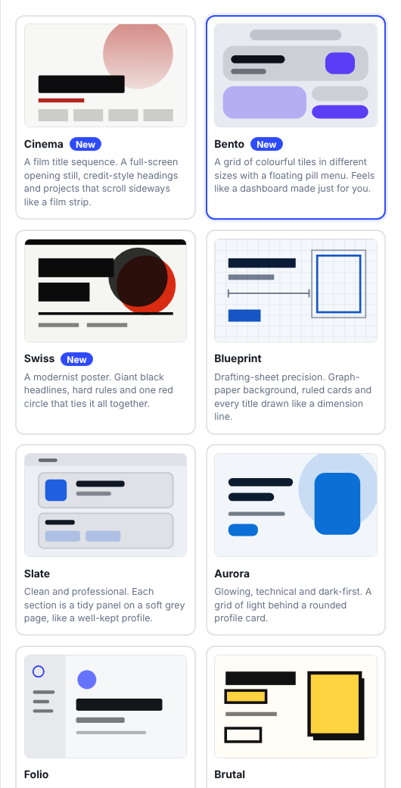

### How does it know which themes are the newest?

By the **`released`** line in each `theme.json`:

```json
"released": "2026-11-22T11:37",
```

Themes are sorted by this value, newest first, and the first three get the badge.

| You write | Meaning |
| --- | --- |
| `"2026-12-05"` | A date only. Fine when your theme is released on a *later day* than the others. |
| `"2026-12-05T18:30"` | Date **and time** (24-hour clock). Use this when you add several themes on the **same day**, so the order is exact. |

> ✅ **Easiest way:** `npm run new-theme -- name "Name"` writes the current date **and time** for you.
> ⚠️ If two themes have exactly the same `released` value, they are ordered by their `order` number and then by name. Give them different times to be sure.

**Want 2 or 5 badges instead of 3?** Open `build.mjs`, find `const NEW_COUNT = 3;` near the top and change the number. That's all.

---

## 7 · A client wants a different theme

Someone who already has a site from you can switch to a newer style without retyping anything:

1. Open your generator website.
2. Press **Project → Open my site (.zip) or project…** (or **I already have a site** on the welcome page) and choose the zip they downloaded earlier. A `portfolio-data.js` file on its own also works.
3. Their words, photos, section order and colours load. The **Style & layout** page opens, showing every current theme including the newest.
4. They pick a theme, check the preview, press **Download site**, and publish the new folder in place of the old one.

> ℹ️ A client's own `admin.html` only knows the themes that were in their zip. To get newer themes they re-open their zip in the generator, as above.

---

## 8 · Run it on your own computer (optional)

You only need this if you want to **make or test themes** before uploading.

1. Install [Node.js](https://nodejs.org) (version 18 or newer; choose the "LTS" download).
2. Open a terminal **inside** the `portfolio-generator` folder. (Windows: open the folder, click the address bar, type `cmd`, press Enter.)
3. Run:

```bash
npm install        # downloads the helpers (once)
npm run build      # checks every theme and creates the dist/ folder
```

4. Open `dist/index.html` (welcome page), `dist/generate.html` (generator) or `dist/gallery.html` (all themes) in your browser.

| Command | What it does |
| --- | --- |
| `npm run build` | Checks all themes and creates the finished site in `dist/`. |
| `npm run dev` | Rebuilds automatically every time you save a file. |
| `npm run new-theme -- id "Name"` | Creates a new theme folder to start from. |
| `npm run check-themes` | Runs only the theme quality check. |
| `npm test` | Runs the automatic end-to-end test (needs Playwright). |

---

## 9 · What is inside each folder?

```
portfolio-generator/
│
├── themes/        ⭐ ONE FOLDER PER THEME. The only place you add or remove themes.
│
├── dist/          The finished site (made by "npm run build", Vercel makes it for you too)
│                    index.html     welcome page
│                    generate.html  the generator
│                    gallery.html   all themes side by side
│
├── docs/images/   The pictures used in this guide
│
├── src/           The source code
│   ├── site/         the generated website (index.html, renderer, base.css)
│   ├── editor/       the form + live preview, shared by the generator AND admin.html
│   ├── generator/    zip export, import, drafts, theme catalog, sample content
│   ├── admin/        the admin page
│   ├── gallery/      the theme gallery page
│   ├── landing/      the welcome page
│   └── brand/        the icon (favicon). Replace these to change it.
│
├── tools/         helpers: new-theme, check-themes, dev watcher
├── test/          automatic tests
├── build.mjs      the build script (checks themes, then writes dist/)
├── vercel.json    tells Vercel how to build and serve
└── package.json   project info and the npm commands
```

> **Rule of thumb:** to add a look → `themes/`. To change how the form behaves → `src/editor/`. To change the welcome page → `src/landing/`.

---

## 10 · Troubleshooting

<details>
<summary><b>The zip won't extract, or Windows says "potentially harmful file"</b></summary>

Windows marks downloaded files as untrusted. Right-click the `.zip` → **Properties** → tick **Unblock** → **OK**, then extract again with **Extract All** (don't drag files out). Still stuck? Use [7-Zip](https://www.7-zip.org).
</details>

<details>
<summary><b>I double-clicked <code>portfolio-data.js</code> and Windows opened a strange error</b></summary>

Never double-click that file. Windows tries to run `.js` files as programs, but it only holds content. Open **`index.html`** (the site) or **`admin.html`** (the editor) instead.
</details>

<details>
<summary><b>My Vercel deploy failed</b></summary>

Most often a theme did not pass the quality check (this protects your live site, the old version keeps running). In Vercel click the failed deploy and read the **build log**. It names the theme and the problem, for example *"text contrast too low in dark mode"* or *"released must be YYYY-MM-DD"*. Fix that file, upload it again, and Vercel retries.
</details>

<details>
<summary><b>I added a theme but it doesn't show up</b></summary>

- Wait about a minute and refresh with **Ctrl + F5** (Mac: **Cmd + Shift + R**).
- Check the folder is directly inside `themes/` and holds all three files: `theme.json`, `theme.css`, `thumb.svg`.
- Check the Vercel deploy finished without a red error.
</details>

<details>
<summary><b>The "New" badge is on the wrong themes</b></summary>

The badge goes to the three themes with the **latest `released` value**. Look at `released` in each `theme.json`. If you added several themes on the same day, add the time (`2026-12-05T18:30`). See [Part 6](#6--the-new-badge-how-it-works).
</details>

<details>
<summary><b>Do I need to pay for anything?</b></summary>

No. GitHub and Vercel are free for a project like this. A custom domain name is the only optional cost.
</details>

<details>
<summary><b>Where is visitors' data stored?</b></summary>

Only in their own browser (and in the zip they download). Nothing is sent to your server. You can't see it, and you don't have to protect it.
</details>

---

## 11 · For developers

**How the theme sync works.** `npm run build` runs the theme checks, then writes `dist/themes/index.json` (every theme, its CSS, and an `isNew` flag). The hosted generator downloads that file when it opens, so it always shows exactly what is in `themes/`. If the download fails, or the page is opened from disk, it falls back to the themes baked into the page.

**The "New" flag.** `build.mjs` sorts themes by `released` (descending), then `order`, then name, and sets `isNew: true` on the first `NEW_COUNT` (3). The editor, gallery and welcome page just read `style.isNew`.

**Add a section to the portfolio.**

1. Add it to `SECTIONS` in `src/site/js/schema.js` and give it an empty value in `emptyData()`.
2. Add a builder in `BUILD` and a filter in `FILTER` in `src/site/js/renderer.js`.
3. Add a panel in `PANELS` and `CONTENT` in `src/editor/editor.js`.

Because the editor is shared, a new field appears in the generator and in every admin page at once.

**Tests.** `node test/e2e.mjs`, `test/catalog.mjs`, `test/landing.mjs`, `test/mobile.mjs`. They need Playwright installed globally, plus the `@fontsource/*` and Font Awesome dev dependencies to serve fonts offline (Vercel skips those).

**Notes.**

- Fonts come from Google Fonts and icons from Font Awesome 6.5 on cdnjs.
- Updating a site means replacing `portfolio-data.js`.
- The screenshots in `docs/images/` were captured from the real app.
